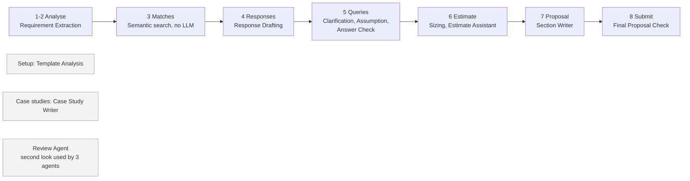
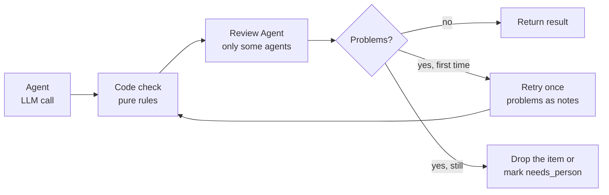

# Agents and Traceability

A plain-language guide to every AI agent in the Revenue Engine AI service and to what each one should send to
Langfuse. Written for engineers and ops people who build, run or debug the service.

> **Status of tracing today.** There is **no Langfuse code** in this service yet. What exists now is JSON logs
> with a request id, a `meta` block on every result (model, prompt versions, token usage, cached or not) and
> a `trace_id` on job callbacks. The "Trace events" sections below describe what **should** be captured. They
> are the design to build, not a description of current behaviour. See [Part 4](#part-4--how-to-add-langfuse).

Source of truth: `src/revenue_engine_ai/` (`agents/`, `services/`, `llm/`, `api/router.py`). Anything in the
README that differs from the code was checked against the code.

---

## Part 1 — The big picture

### What the service is

The AI side of the proposal builder. The backend (`stc-revenue-engine-api`) owns all business data and calls
this service over HTTP with a short-lived JWT. The service **never changes business state, never sees another
workspace's data and never writes a price**.

### How the agents are used

Code decides what runs and in what order. No AI chooses the next step.



### The loop every agent follows



Rules that apply to all agents:

- **Check in code.** The model's answer is never trusted as it is. Quotes must exist in the source, amounts are
  refused, lengths are capped.
- **One retry at most**, and the retry gets the problems as notes. Not every agent retries (see each one).
- **No prices.** Any text with a currency amount or a price/cost/fee word next to a number is dropped.
- **Cache.** Results are stored in `result_cache`, keyed by a hash of everything that shaped them (input, model,
  prompt versions, library content). A cache hit makes **no LLM call** and returns `meta.cached = true`.
- **Pinned versions.** Each agent has a `PROMPT_VERSION`. Changing a prompt means bumping it, so it changes the
  cache key.
- **Workspace isolation.** The workspace comes only from the JWT. Each workspace uses its own AI provider and key.

### Quick reference

| Agent | Where it runs | LLM call(s) | Effort | Review Agent | Retry |
|---|---|---|---|---|---|
| Requirement Extraction | job `rfp_analysis`, `POST /rfp/analyse` | 1 per page window | medium | yes | once, only for misquotes |
| Response Drafting | `POST /proposals/draft-answers` | tool loop per question | medium | yes | once |
| Clarification | `POST /proposals/client-queries` | 1 | low | yes | once, only to make up a shortfall |
| Assumption | `POST /proposals/clarifications/assume` | 1 | low | no | once, only for missing ids |
| Answer Check | `POST /proposals/clarifications/check-answer` | 0 or 1 | low | no | none |
| Sizing | `POST /proposals/size-requirements` | 1 | low | no | none (median fallback) |
| Estimate Assistant | `POST /proposals/estimate-request` | 1 | low | no | once, when an action was dropped |
| Section Writer | `POST /proposals/write-sections` | 1 | medium | no | once, for empty sections |
| Template Analysis | job `template_extract` | 1 (+1 vision if no headings) | low | no | none (reader's result is the fallback) |
| Final Proposal Check | `POST /proposals/final-check` | 1 per page window | low | no | none |
| Case Study Writer | `POST /case-studies/write` | 1 | medium | no | once |
| Review | called by other agents | 1 per batch of 20 items | medium | n/a | none |

Efforts are the defaults in `core/config.py` (`RE_AI_*_EFFORT`). The model default is the pinned snapshot
`gpt-5.5-2026-04-23`, but each workspace's own provider and model replace it.

---

## Part 2 — Shared building blocks

These are not agents, but every trace passes through them.

### Request entry (every endpoint)

1. `X-Request-Id` header is read, or a new id is made. It is put in a context variable and added to every log
   line and to the response.
2. The service JWT (HS256, audience `revenue-engine-ai`, issuer `revenue-engine-api`) is verified. The claims
   give `workspace_id`, `actor_id`, `can_see_restricted`, `request_id` and the workspace's `ai_provider`
   settings.
3. `WorkspaceLLMs.get(ctx)` builds, or reuses for 300 s, that workspace's LLM client. The API key is read from
   the secret store at a path made from the workspace id. It never travels in the token.

**Failures here:** no or bad token → `401`. No provider saved → `422 ai-provider-not-set`. Key missing or
unreadable → `502` with a plain message. Provider rejects the key → `422 ai-credential-rejected`.

### The LLM port (`llm/ports.py`)

Every agent calls `llm.structured(AgentCall)` or `llm.with_tools(AgentCall, tools, max_tool_calls)` and gets a
`Completion(value, usage)`. `AgentCall.agent` is a stable name (`extraction`, `drafting`, `review`, …).
`Usage` counts `input_tokens`, `output_tokens`, `calls` and `tool_calls`.

Two providers implement it:

- **Responses API** (`openai_provider.py`): strict JSON schema output, `store=False`.
- **Chat Completions** (`chat_completions_provider.py`, for gateways such as Yantra): the schema goes in the
  prompt, the answer is validated, and a wrong answer is sent back **once** to be corrected (this adds a call
  to `usage`). Tool-using calls run with reasoning off. An answer cut off by the output limit fails at once.

**Provider failures** become plain errors in `llm/failures.py`. The provider's message is never kept, because it
can echo the key.

| Provider problem | Becomes | HTTP |
|---|---|---|
| Authentication or permission | `ai-credential-rejected` | 422 |
| Rate limit or quota | "limiting requests or out of quota" | 502 |
| Unknown model | "does not have the model chosen" | 502 |
| Cannot connect or timeout | "could not be reached" | 502 |
| No parsed answer, tool budget exceeded, truncated | "did not answer" style message | 502 |

**Important behaviour:** when several calls run in parallel (page windows, questions) and one raises, the whole
request fails. There are no partial results.

### Jobs (`POST /v1/jobs`, types `rfp_analysis` and `template_extract`)

Accepted at once (`202 {job_id}`), run inside the service (at most 4 at a time), idempotent per
`(workspace, idempotency_key)`. While running, the job POSTs signed events to the `callback_url`:
`progress` (one try), then one `succeeded` or `failed`. A final event is retried (3 tries, same `event_id`).
Every event carries `trace_id`, which is set to the **job id**, and `usage`.

**Failures:** unknown type `job_type` (422), bad input `job_input` (422), file link outside the allowed storage
prefixes `file_url` (422), download fails `file_url`, file too large `file_size`. A domain error becomes a
`failed` event with its message (max 2000 chars). Any other exception is logged as `job_crashed` and sent as
"Something went wrong while running this job on our side." A job lost by a restart is not resumed.

### Review Agent (second look)

| | |
|---|---|
| **Purpose** | Independent check: is each statement fully supported by its evidence and the rule? |
| **Input** | Items of `{id, statement, evidence[], rule}`. It never sees the other agent's reasoning. |
| **Processing** | Items are split into batches of 20 and judged in parallel. Each gets `supported` true/false with a one-sentence reason. |
| **External** | The workspace LLM (structured call, medium effort). |
| **Output** | `failed: {item id → reason}` plus usage. An item with **no verdict fails** (deny by default). |
| **Used by** | Extraction (features and custom requirements), Drafting (the answer), Clarification (each question). |
| **Failure points** | LLM errors raise like any other call. A missing verdict becomes "The reviewer gave no verdict." |
| **Trace events** | One span `review` per call with `items_count`, `batches`, `failed_count`, `missing_verdict_count`, and the `rule` text. One event per failed item with its id and reason. One generation per batch. |

### Semantic search and Library indexer (no LLM)

Not agents, but they feed Matches (Step 3) and Drafting, and they cost time.

- **Indexer** (`PUT /library/entries/{id}`, `PUT /library/documents/{id}`): content hash check (unchanged
  entries are skipped) → parse → split into passages → amounts removed → embed locally (fastembed
  `BAAI/bge-small-en-v1.5`, nothing leaves the service) → store in Qdrant + Postgres.
  Failures: `content` (nothing to index), file type/size/unreadable rules.
- **Search** (`/library/similar`, `/library/search`): embed the query → exact cosine scan, ties by id → threshold
  filter. Failures: `library_not_indexed` for drafting; `NotFound` when deleting a missing entry.
- **Trace:** span `library.index` (`entry_id`, `kind`, `passages`, `unchanged`) and span `library.search`
  (`query_len`, `candidates`, `results`, `threshold`, `embedding_model`). No generation, since no LLM.

---

## Part 3 — The agents

Each agent below uses the same headings. "Common events" are defined once in
[Part 4](#common-events-every-agent-emits) and not repeated; only agent-specific events are listed per agent.

### 1. Requirement Extraction Agent

**Purpose.** Reads an RFP and fills a fixed form: catalogue features the client asks for, requirements no
catalogue entry covers, the RFP's own questions, required documents, key facts (client, due date, start date,
budget), unclear points and a short summary. Every item carries a quote and a page.

**Input.** The RFP file (PDF, DOCX, XLSX or TXT) and the feature catalogue `[{key, label, commodity, kw}]`. As a
job, the file arrives as `file_url` plus filename, client, industry and engagement model.

**Processing steps** (`services/analyse.py`)
1. Build the cache key (file SHA-256, catalogue, model, prompt versions). On a hit, return at once.
2. Progress "Reading the document". Parse the file. Pages with no text layer are read by OCR (RapidOCR on pdfium
   renders, at most 100 pages).
3. Split the pages into windows of about 60,000 characters (about 15k tokens).
4. Progress "Finding requirements…". For each window **in parallel**:
   1. *Extract* (LLM). The feature `key` is an enum of the catalogue, so the model cannot invent one.
   2. *Check* (code). Each quote must be on the cited page, or on any page (the page is corrected).
      Items with a quote not in the document are rejected.
   3. *Review* (Review Agent) of features and custom requirements against "the evidence must show the client
      asks for this capability". Rejected items are dropped and are **not** re-extracted.
   4. *Retry once* only if something was **misquoted**, with those problems as notes.
5. Progress "Putting the results together". Merge windows in page order (first mention wins; the first window's
   summary describes the whole RFP). Map to the contract. Store in cache.

**External services and tools.** Workspace LLM (extraction + review), pdfium + RapidOCR (local), Postgres
(`result_cache`), object storage download (for jobs).

**Data appended or enriched.** Page numbers corrected to where the quote really is. Confidence clamped to 0–1
and rounded. Features split into `core` and `standard` by the catalogue's `commodity` flag, with
`standard_evidence`. `unmatched` (custom requirements). `rejected` (what was dropped and why). `ocr` (bool),
`pages` (count). `meta` (model, prompt versions, usage, cached).

**Output.** `AnalyseResult`: `summary`, `core`, `standard`, `standard_evidence`, `unmatched`, `due_date`,
`start_date`, `budget_hint`, `client`, `questions`, `required_documents`, `documents`, `unclear_points`,
`rejected`, `ocr`, `pages`, `meta`.

**Failure points and handling**

| What fails | What happens |
|---|---|
| Unsupported type, too big, unreadable, no readable text | `422` rules `file_type`, `file_size`, `file_unreadable`, `file_empty`. As a job: `failed` event. |
| OCR crashes | Logged `ocr_failed`. The scan is refused with "has no readable text" if nothing else is readable. |
| Quote not in document | Asked again **once**. Still wrong → item goes to `rejected`. |
| Reviewer says not supported or gives no verdict | Item dropped and listed in `rejected`. |
| Download fails (job) | `file_url`: "could not download the document (the link may have expired)". |
| LLM error in any window | Whole analysis fails (`502`, or `422` for credentials). |

**Trace events to capture**
- Span `rfp.analyse`: `filename`, `file_sha256`, `bytes`, `catalogue_size`, `mode`, `job_id`.
- Event `cache_lookup` (hit or miss) and, on a hit, stop there.
- Span `parse`: `pages`, `ocr_used`, `ocr_pages`, `windows`, duration.
- Per window, span `window[i]` (pages from–to) containing:
  generation `extraction` → span `check.quotes` (`kept`, `rejected_misquote` per kind) → span `review` →
  event `retry_misquote` (with the notes) when it happens.
- Event `item_rejected` for every rejection: `{kind, label, reason, source: "quote" | "reviewer"}`.
- Event `progress` for each of the 3 steps.
- Span `merge`: counts before and after de-duplication.
- Output summary on the trace: counts of `core`, `standard`, `unmatched`, `questions`, `rejected`.

---

### 2. Response Drafting Agent

**Purpose.** Drafts an answer to one RFP question using only past proposals the user selected, with every claim
backed by a quoted passage.

**Input.** `questions [{id, text, draftable}]`, `selected_entry_ids`, `rfp_summary`, `requirements`.

**Processing steps** (`services/drafting.py`). Questions run **in parallel**; database access is serialised by a
lock.
1. Check that every selected entry is indexed (else `library_not_indexed`).
2. Choose sources: selected entries **except lost ones**, won ones first, then by id.
3. Per question, in order:
   - not `draftable` → `skipped` ("A person writes this one").
   - pricing question (code rule) → `skipped_pricing`.
   - no usable source (only lost proposals) → `needs_person`.
   - cache lookup (question, context, content hashes, model, versions).
   - **Draft** (LLM with tools, up to 5 tool calls): `search_library` (top 5 passages) and `get_passage`.
     Every read passage is recorded.
   - Model says not enough material, or empty answer → `needs_person` straight away (no retry).
   - **Check** (code): each claim cites a passage that was retrieved, its quote is in that passage, no amount in
     the answer, at least one claim.
   - **Review** of the answer against the claim quotes ("every fact supported, no prices").
   - Any problem → **retry once** with the problems as notes. Still failing → `needs_person` with the reason.
4. Only `drafted` answers are cached.

**External services and tools.** Workspace LLM with function tools, local embedder (to embed search queries),
Qdrant + Postgres (search and passage fetch), Review Agent, `result_cache`.

**Data appended or enriched.** `claims` with `entry_id` and `page` filled from the retrieved passage.
`citations` with the proposal title. `confidence` = 0.9 if accepted first time, 0.7 if only after a correction.
`no_confident_source` is true for `needs_person`.

**Output.** Per question `{id, status, answer, claims, citations, confidence, no_confident_source, reason}`
where `status` is `drafted`, `needs_person`, `skipped_pricing` or `skipped`, plus `meta`.

**Failure points and handling**

| What fails | What happens |
|---|---|
| Entry not indexed | `422 library_not_indexed`. |
| Claim cites an unread passage, or quote not in passage, or amount in answer | Retry once, then `needs_person`. |
| Reviewer says not supported | Retry once with "Reviewer: …" notes, then `needs_person`. |
| Model keeps calling tools | Tools switch off after 5 calls; hard stop after 7 turns → `502`. |
| Model calls an unknown tool or sends bad JSON | The tool returns an error text the model can read. Not a failure. |
| LLM or provider error | Whole request fails. |

**Trace events to capture**
- Span `draft.question[id]`: `question_id`, `status`, `confidence`, `attempts`.
- Event `skipped` with `reason: not_draftable | pricing | only_lost`.
- Generation `drafting` per attempt, with `tool_calls` count.
- One **tool span per tool call**: `search_library` (`query`, `hits`, passage ids and similarities) and
  `get_passage` (`passage_id`, `found`). This is what makes a drafted answer explainable.
- Span `check.claims`: `claims_total`, `claims_kept`, and each problem.
- Span `review` (as above).
- Event `retry` with notes. Event `needs_person` with the final reason.
- Trace-level: `sources_count`, `lost_excluded_count`, `questions_total`, `drafted`, `needs_person`, `skipped`.

---

### 3. Clarification Agent

**Purpose.** Suggests questions to send to the client, each with why we ask, a sample answer and the assumption
we will price on if the client does not reply ("Suggest with AI" asks for 3).

**Input.** Requirements (key, label, covered by a past project or not), unclear points, engagement model,
existing questions, existing assumptions, `limit`.

**Processing steps** (`services/clarification.py`)
1. Cache lookup.
2. **Ask** (LLM).
3. **Check** (code): `about` must be a given topic id; no money amount; not a near-repeat of an existing
   question; not already settled by an existing assumption.
4. **Review** each kept question ("clear, on the topic in the evidence, assumption is safe and conservative").
5. If there were problems **and** fewer than `limit` questions survived: **retry once** with the problems as
   notes, merge with the good ones from the first round and re-check. Trim to `limit`.
6. Cache.

**External services and tools.** Workspace LLM, Review Agent, `result_cache`.

**Data appended or enriched.** `dropped` (a note for every question that was removed), `meta`.

**Output.** `questions[]` and `dropped[]`, `meta`.

**Failure points and handling**

| What fails | What happens |
|---|---|
| Wrong topic id, amount, duplicate | Question dropped, listed in `dropped`. |
| Reviewer rejects | Dropped, listed in `dropped`. |
| Shortfall after the first round | One retry. If still short, fewer questions are returned. This is not an error. |
| LLM error | Request fails. |

**Trace events to capture**
- Span `clarify`: `limit`, `requirements_count`, `unclear_points_count`, `existing_questions_count`.
- Generation `clarification` per round, with `round: 1|2`.
- Span `check.rules` with reason counts: `bad_topic`, `amount`, `duplicate`, `settled_by_assumption`.
- Span `review`. Event `retry_shortfall` with `kept` and `limit`.
- Trace-level: `returned`, `dropped`.

---

### 4. Assumption Agent

**Purpose.** For each open client question, writes one conservative assumption to estimate on, with its risk.

**Input.** `rfp_summary`, `engagement_model`, `requirements`, `questions [{id, question, category, why}]` (1–60,
unique ids).

**Processing steps** (`services/assumptions.py`)
1. Cache lookup.
2. **Ask** (LLM, low effort, one call for all questions).
3. **Check** (code): keep the first answer per known id; drop unknown ids; clip `assumption` to 400 chars and
   `risk` to 300; drop anything mentioning money.
4. Any id still missing → **one retry** for those ids only.
5. Any id still missing → a **generic conservative assumption** from code.
6. Cache.

**External services and tools.** Workspace LLM, `result_cache`. No review.

**Data appended or enriched.** Generic fallback text where the model gave nothing usable. A default risk text if
the risk was empty. `meta`.

**Output.** `assumptions[{id, assumption, risk}]`, **exactly one per question, in the request's order**, and `meta`.

**Failure points and handling**

| What fails | What happens |
|---|---|
| Missing, duplicate, unknown id, money in text | Skipped; missing ids retried once, then generic fallback. Never an error. |
| LLM error | Request fails. |

**Trace events to capture**
- Span `assume`: `questions_count`.
- Generation `assumption` (attempt 1, and attempt 2 if it happens).
- Event `retry_missing` with `missing_ids`.
- Event `fallback_generic` with `ids` (important: shows where the model did not deliver).
- Trace-level: `model_assumed`, `generic_used`.

---

### 5. Answer Check Agent

**Purpose.** While the user waits, decides whether a typed answer really answers its clarification question.

**Input.** `question`, `why`, `category`, `answer`.

**Processing steps** (`services/answer_check.py`)
1. **Pre-check in code, no model**: no words → not acceptable; digits only when the question does not ask for a
   number → not acceptable. This result is returned immediately and is not cached.
2. Cache lookup.
3. **Judge** (LLM, low effort).
4. **Check** (code): reason empty when acceptable; reason and suggestion clipped to 300 chars; a suggestion with
   money is replaced by a generic one; a rejection with no reason gets "does not answer the question yet".
5. Cache.

**External services and tools.** Workspace LLM (only when the pre-check passes), `result_cache`.

**Data appended or enriched.** Generic suggestion text where needed. `meta`.

**Output.** `{acceptable, reason, suggestion, meta}`.

**Failure points and handling.** Almost none: the code pre-check and clean-up cover bad inputs and bad text.
Only an LLM or provider error fails the request.

**Trace events to capture**
- Span `answer_check`: `answer_len`, `category`.
- Event `precheck_rejected` with `reason: no_words | digits_only` (no generation follows).
- Generation `answer_check`. Event `suggestion_replaced` when money forced a generic suggestion.
- Trace-level: `acceptable`. Because this runs while a person waits, record **latency** as a first-class value.

---

### 6. Sizing Agent

**Purpose.** Gives each requirement a size class (XS, S, M, L, XL) from industry benchmarks, which is the
estimate's starting effort. The model never writes days or prices.

**Input.** `industry` and `requirements [{key, label, detail}]` (1–80, unique keys).

**Processing steps** (`services/sizing.py`)
1. Cache lookup.
2. **Ask** (LLM, low effort).
3. **Check** (code): one size per requirement, in order. The first answer per key wins. Days come from a code
   table (XS 5, S 10, M 20, L 40, XL 80). A requirement not sized, or with an empty rationale or one that
   mentions money, gets **M (20 days)** with "Not sized by AI; industry median used."
4. Cache.

**External services and tools.** Workspace LLM, `result_cache`.

**Data appended or enriched.** `days` from the code table, fallback rationale, `meta`. The table is versioned
as `size-days-v1` in the cache key.

**Output.** `sizes[{key, size, days, rationale}]` and `meta`.

**Failure points and handling.** Missing or bad entries fall back to M and never fail. Only an LLM or provider
error fails the request.

**Trace events to capture**
- Span `size`: `industry`, `requirements_count`.
- Generation `sizing`.
- Event `fallback_median` with the keys, and the reason (`not_returned | empty_rationale | money`).
- Trace-level: histogram of sizes, `total_days`.

---

### 7. Estimate Assistant Agent

**Purpose.** Turns a request about the estimate ("extend the timeline to 30 weeks", "reduce the cost by 20%",
"drop the driver app", "why 26 weeks?") into actions the backend applies. A question gets an answer and no
action. It never sees a price.

**Input.** `ask` (1–500 characters, money already replaced by `[AMOUNT_n]` references), `amounts`, and `state`
(engagement model, delivery approaches, weeks, team and its min/max, person-days, in-scope and out-of-scope
items with `must`, `price_set`, `team_set`, `can_change_price`).

**Processing steps** (`services/estimate_assistant.py`)
1. Cache lookup.
2. **Ask** (LLM, low effort).
3. **Check** (code), action by action:
   - `leave_out`: must be in scope and **never a Must-have**.
   - `add_back`: must be out of scope.
   - `delivery_approach`: must be listed and not already chosen.
   - `set_timeline`: 1–520 weeks. `set_team`: within `team_min..team_max`.
   - `set_price` / `reset_price`: only when `can_change_price`; exactly one of `amount_ref` or `percent`;
     `amount_ref` must be one of the request's references; percent within the allowed range.
   - at most one change per group (approach, timeline, price) and one per scope item; max 10 actions.
   - message clipped to 600 chars; a message with money is replaced.
4. If any action was dropped → **retry once** with a note per dropped action. The second result is used as it
   comes.
5. Cache.

**External services and tools.** Workspace LLM, `result_cache`. No review.

**Data appended or enriched.** Default messages ("I made the changes listed below.", "The estimate below shows
the figures after the changes.", or an "unclear" message) when the model's message is empty or unsafe. `meta`.

**Output.** `{understood, message, actions[{kind, key, weeks, team, amount_ref, percent}], meta}`. The backend
applies the actions and computes every figure.

**Failure points and handling**

| What fails | What happens |
|---|---|
| Action not allowed by the estimate | Dropped with a note, one retry. |
| Message contains money | Replaced. |
| Request not understood | `understood=false`, no actions. |
| LLM error | Request fails. |

**Trace events to capture**
- Span `estimate_request`: `ask_len`, `amounts_count`, `can_change_price`, `weeks`, `team`.
- Generation `estimate_assistant` (attempt 1, 2).
- Event `action_dropped` for each: `{index, kind, reason}`. This is the most useful signal for prompt tuning.
- Event `retry_actions`. Event `message_replaced`.
- Trace-level: `understood`, `actions_returned`, action kinds. **Do not** log the raw `ask` text without masking,
  since users type amounts.

---

### 8. Section Writer Agent

**Purpose.** Writes each proposal section from the facts only, following the template's guidance for that
section. Missing facts read `[to be completed]`.

**Input.** `sections [{key, title, guidance}]` (1–30, unique keys) and `facts` (client, title, summary,
industry, engagement model, delivery approach, requirements, standard features, modules, timeline weeks, team
size, assumptions, clarifications Q&A, past experience).

**Processing steps** (`services/proposal_writing.py`)
1. Cache lookup.
2. **Write** (LLM, medium effort, all sections in one call).
3. **Check** (code): only requested keys, first answer per key; markup stripped (tags, markdown, bullets,
   emphasis); any paragraph with money dropped (and noted in `dropped`); each paragraph clipped to 1200 chars
   after the last whole sentence; at most 5 paragraphs.
4. Sections with no paragraph → **one retry** for just those sections, with a note.
5. Any section still empty → `[to be completed]`.
6. Cache.

**External services and tools.** Workspace LLM, `result_cache`. Nothing is retrieved; the facts are the only
source. No review.

**Data appended or enriched.** `dropped` (notes on removed paragraphs), the placeholder text, `meta`.

**Output.** `sections[{key, paragraphs}]`, `dropped[]`, `meta`.

**Failure points and handling.** Money, markup and length are repaired or dropped in code. Empty sections get
one retry and then the placeholder. Only an LLM or provider error fails the request.

**Trace events to capture**
- Span `write_sections`: `sections_count`, `facts_keys`.
- Generation `section_writer` (attempt 1, 2).
- Event `paragraph_dropped` (`section`, `reason: money`) and `paragraph_clipped`.
- Event `retry_empty_sections` with keys. Event `placeholder_used` with keys.
- Trace-level: `sections_written`, `placeholders`, `dropped_count`.

---

### 9. Template Analysis Agent

**Purpose.** Improves what the template reader found in a DOCX template: section key, generated or boilerplate,
and writing guidance in the template's voice. If the template has fewer than 2 headings but has pictures, reads
the section headings from up to 4 pictures (vision).

**Input.** Job `template_extract`: `file_url`, `filename`, `kind` (`proposal` or `case_study`).

**Processing steps** (`services/templates.py`)
1. Download the file (from an allowed prefix).
2. **Read the DOCX in code** (headings, styles, page, cover). Deterministic.
3. If headings < 2 and the file has embedded pictures: **vision call** (LLM) on up to 4 images (as data URLs).
   If it finds at least 2 sections, they replace the reader's.
4. **Review sections** (LLM, low effort): key, kind, guidance for every section.
5. **Merge in code**: the model only improves the result. Keys must be valid and unique; titles, order and fixed
   text stay as the document has them; guidance containing money is dropped.

**External services and tools.** Workspace LLM (text, and vision when needed), the DOCX reader (local),
object storage download.

**Data appended or enriched.** Warnings are added to the spec: "reviewed by AI", "read from its pictures by AI",
or "not reviewed". Confidence is raised for reviewed sections (capped at 0.95).

**Output.** The backend's `TemplateSpec`: `branding`, `page`, `header`, `footer`, `cover`, `sections`,
`confidence`, `warnings`, plus `usage`.

**Failure points and handling**

| What fails | What happens |
|---|---|
| File is not a readable Word document | Job `failed`: "could not be read as a Word document". |
| LLM or provider error (any `DomainError`) | **The job still succeeds.** The reader's result is returned with the "not reviewed" warning. Logged as `template_review_skipped`. |
| Any other (non-domain) exception | Job `failed` with the generic message. |

**Trace events to capture**
- Span `template.extract`: `kind`, `bytes`, `heading_count`, `images_found`.
- Span `reader` (deterministic), then, if used, generation `template_vision` with `images_count`.
- Generation `template_analysis`.
- Event `review_skipped` with the error class. This is the one to alert on, because the user sees a worse
  template without an error.
- Trace-level: `sections_count`, `warnings`.
- Privacy: customer template text goes into the prompt. Mask it in traces by default.

---

### 10. Final Proposal Check Agent

**Purpose.** Reads the user's own final proposal (1–2 files) and compares what it states with the approved draft.
The model only finds facts with quotes. Code decides everything else and writes the five findings.

**Input.** `files` (1–2: for example a technical and a commercial file, read as one document) and
`draft {price, weeks, core_features, responses, attachments, …}`.

**Processing steps** (`services/final_check.py`)
1. `report_price = can_see_restricted` (from the JWT). Cache lookup.
2. Parse all files into one page sequence (OCR for scans, pages renumbered across files).
3. Split into windows. For each window **in parallel**: **read** (LLM, low effort): price, weeks, features,
   answers (does the document's answer match the approved response?), attachments, each with a quote.
4. **Check** (code): a fact stays only if its quote is in the document. A price or weeks figure must also have
   its number inside its quote (understands `820.000`, `1,200,000`, `1.2m`). Weeks must say "week". Features,
   answers and attachments must be ones the draft has.
5. Merge windows (first figure wins).
6. **Findings in code**, always in this order: Scope, Cost, Timeline, Responses, Attachments. The texts are
   fixed sentences with counts.
7. Cache.

**External services and tools.** Workspace LLM, parsing and OCR (local), `result_cache`. No review, no retry.

**Data appended or enriched.** `files` names, `checked: true`, the price found and the draft price (only with
`can_see_restricted`), weeks found and draft weeks, `findings`, `meta`.

**Output.** `FinalCheckResponse` with `findings[{area, ok, text, from, to}]`. Without restricted access the Cost
finding reads "Not compared: prices are restricted for your role."

**Failure points and handling**

| What fails | What happens |
|---|---|
| Unreadable or empty file, wrong type, too big | `422` file rules. |
| Quote missing or number not in the quote | That fact is discarded. The finding says "not found". |
| LLM or provider error in any window | Request fails. |

**Trace events to capture**
- Span `final_check`: `files_count`, `pages`, `windows`, `ocr_used`, `report_price`.
- Generation `final_check` per window.
- Span `check.facts`: for each of price, weeks, features, answers, attachments: `found` and `kept`, and the
  discard reason (`quote_missing | number_not_in_quote | not_in_draft`).
- Event `finding` for each of the five findings: `{area, ok}`.
- **Never** put the price (found or draft) in a trace when `report_price` is false.

---

### 11. Case Study Writer Agent

**Purpose.** Writes a case study from a decided past proposal: a customer story for a won bid, lessons learned
for a lost one. Written in the case study template's sections, plus title, summary, metrics, and the common
layout (about the client, challenges, solution and pillars, features, why us).

**Input.** `entry_id`, `facts {client, title, industry, engagement_model, outcome (won|lost), reason, weeks,
features}` and `template [{key, title, guidance}]` (up to 30).

**Processing steps** (`services/case_studies.py`)
1. If the proposal is indexed: embed 3 fixed questions (the client's business and problem, our solution, the
   results) and search **within that entry**. Keep up to 4 hits per question, at most 10 distinct passages, each
   cut to 1500 chars. If it is not indexed, use the facts only.
2. Cache lookup. The passage ids are part of the key, so re-indexing means rewriting.
3. **Write** (LLM, medium effort).
4. **Check** (code): plain text within limits; anything with money dropped (the engagement model's name is not
   money); a **metric kept only if its number appears in the facts or passages**; `sources` limited to passages
   that were really given; every template section present.
5. Title or summary empty, or sections missing → **one retry** with the notes.
6. Cache.

**External services and tools.** Workspace LLM, local embedder, Qdrant + Postgres (passage search), `result_cache`.

**Data appended or enriched.** `sources [{passage_id, page}]` linked to the real passages, `dropped` notes,
`meta`.

**Output.** `title`, `summary`, `metrics`, `industry`, `scope`, `engagement`, `about_client`, `challenges`,
`solution_intro`, `solution_pillars`, `features`, `why_us`, `sections`, `sources`, `dropped`, `meta`.

**Failure points and handling.** Invented metrics and money are removed. Missing parts get one retry; what is
still missing stays missing, with a note in `dropped`. An LLM or provider error fails the request.

**Trace events to capture**
- Span `case_study`: `entry_id`, `outcome`, `template_sections`.
- Span `retrieve.passages` (`indexed`, `queries: 3`, `passages_used`, ids). Event `not_indexed_facts_only`.
- Generation `case_study_writer` (attempt 1, 2).
- Event `metric_dropped` (`reason: money | number_not_in_source`), `field_dropped`, `section_missing`.
- Event `retry_incomplete`.
- Trace-level: `metrics_kept`, `sources_count`, `dropped_count`.

---

## Part 4 — How to add Langfuse

### What exists that you can build on

| Existing | Where | Use for tracing |
|---|---|---|
| `X-Request-Id` (also the JWT `request_id` claim) | `core/observability.py`, `core/security.py` | Trace id for synchronous endpoints, so a Langfuse trace joins the backend's logs. |
| `job.id` sent as `trace_id` in every callback event | `services/jobs.py` | Trace id for jobs. The backend already stores it. |
| `Usage` (input, output, calls, tool_calls) | `llm/ports.py` | Token counts for each generation. |
| `meta` (model, `prompt_versions`, usage, cached) | `services/common.py` | Attach to the trace as metadata. |
| Single choke point for every model call | `WorkspaceLLMs.get(ctx)` returns the `LLM` | Wrap it once to see every agent. |
| Existing log events | `llm_call_failed`, `llm_answer_invalid`, `llm_answer_truncated`, `ocr_failed`, `template_review_skipped`, `job_submitted`, `job_crashed`, `callback_*` | Same moments become trace events or error levels. |

> Note: `ServiceContext.request_id` is read from the token but the services do not use it today; the logs use the
> header's id. Pick one source for the trace id (prefer the JWT claim, since it is signed) and use it everywhere.

### Trace shape

```
trace  "<endpoint or job type>"      id = request_id (sync) | job_id (job)
│      user_id = actor_id
│      metadata: workspace_id, env, endpoint, job_id, can_see_restricted, prompt_versions, model, cached
├─ span  step                         e.g. parse, window[0], draft.question[q1]
│   ├─ generation  <AgentCall.agent>  extraction | drafting | review | …
│   │     model, model_parameters {effort, api_mode}, usage {input, output}, level
│   │   └─ span tool:search_library   (drafting only)
│   ├─ span  check                    code check, with counts and reasons
│   ├─ span  review                   Review Agent (its own generations inside)
│   └─ event retry / item_rejected / fallback …
└─ scores  review_pass_rate, dropped_count, confidence, cache_hit
```

### Where to put the code

1. **`TracedLLM` wrapper** around the `LLM` port (in `llm/`, applied inside `WorkspaceLLMs.get`). It opens one
   generation per `structured` or `with_tools` call, named `call.agent`, and records model, effort, usage,
   the number of images and errors. Chat Completions repair attempts show up as extra usage.
2. **Tool spans** in `drafting.Library.tools()` (wrap `Tool.run`), so each `search_library` and `get_passage` is
   one span. This is not covered by the wrapper because tools are not LLM calls.
3. **A small `step()` helper** used in `services/*.py` around cache lookup, parse, check, review, retry and merge.
   These are plain code, so the LLM wrapper cannot see them. This is where most debugging value is.
4. **Trace start and end** in the router dependency (sync endpoints) and in `JobRunner._run` (jobs). Flush when
   a job finishes, since it keeps running after the HTTP response.
5. **Settings**: `RE_AI_LANGFUSE_PUBLIC_KEY`, `RE_AI_LANGFUSE_SECRET_KEY`, `RE_AI_LANGFUSE_HOST`, and an off
   switch. With no keys the helpers do nothing.

### Common events every agent emits

| Event | When | Fields |
|---|---|---|
| `cache_lookup` | Every cached use-case, first thing | `hit: bool`, `key_prefix` (first 8 chars), `kind`. On a hit, no generation follows. |
| `generation` | Every LLM call | `agent`, `model`, `effort`, `attempt`, `input_tokens`, `output_tokens`, `images`, `latency_ms`, `finish: ok | error`. |
| `check_failed` | Code check dropped something | `agent`, `item`, `reason`. |
| `review_failed` | Review Agent rejected an item | `agent`, `item_id`, `reason`. |
| `retry` | A second attempt starts | `agent`, `why`, `notes_count`. |
| `fallback_used` | Code replaced a missing model result | `agent`, `what` (median, generic assumption, placeholder, reader result). |
| `provider_error` | `provider_failure` raised | `agent`, `error_class`, `http_status`, mapped rule. **Never the provider's message.** |
| `llm_answer_invalid` | Chat Completions repair round | `agent`, `attempt`, `error_count`. |
| `llm_answer_truncated` | Output limit hit | `agent`. |
| `needs_person` / `skipped` | Result handed back to a human | `agent`, `item`, `reason`. |
| `job.progress` / `job.final` | Job events | `done`, `total`, `status`, `callback_delivered`, `attempts`. |

Levels: `ERROR` for anything that fails the request or job, `WARNING` for `fallback_used`, `needs_person`,
`review_skipped` and callback failures, `DEFAULT` otherwise.

### Scores worth recording

- `cache_hit` (0/1) on every trace.
- `review_pass_rate` = items passed ÷ items reviewed, for Extraction, Drafting and Clarification.
- `dropped_count` per trace (Extraction `rejected`, Clarification `dropped`, Section Writer, Case Study).
- `confidence` on each Drafting answer (0.9 or 0.7).
- `fallback_count` (Sizing median, Assumption generic, Section placeholder). A rising value means a prompt
  regression.

### Safety rules for what goes into a trace

- **Documents are client data.** RFPs, proposals and templates may contain personal and commercial detail. Do
  not send full document text by default. Send ids, hashes, lengths, page numbers and short quotes. Make full
  prompt capture an explicit setting, per environment.
- **No prices.** Prices are already removed from indexed text and refused in output. Keep it that way in traces:
  never record the draft or found price when `report_price` is false, and never the raw Estimate Assistant `ask`
  without masking amounts.
- **No secrets.** Never record the workspace API key, the service token or the callback secret.
  `provider_failure` already hides provider messages, so keep using it.
- **Tracing must never break a request.** All Langfuse calls are best-effort, time-boxed and swallow their own
  errors. Flush in the background.
- **Workspace isolation.** Always set `workspace_id` as metadata so traces can be filtered by tenant, and give
  Langfuse access accordingly.

### Gaps this design would close today

- A failed or odd result cannot be traced back to the exact prompt version, model and passages used, except by
  reading logs by hand.
- There is no record of **why** items were dropped (`rejected`, `dropped` are returned but not kept anywhere).
- Token cost per agent, per workspace and per day is not visible, only per call in `meta`.
- Silent degradations are invisible: template review skipped, generic assumptions, median sizes.
- A restart loses a running job without any trace.
